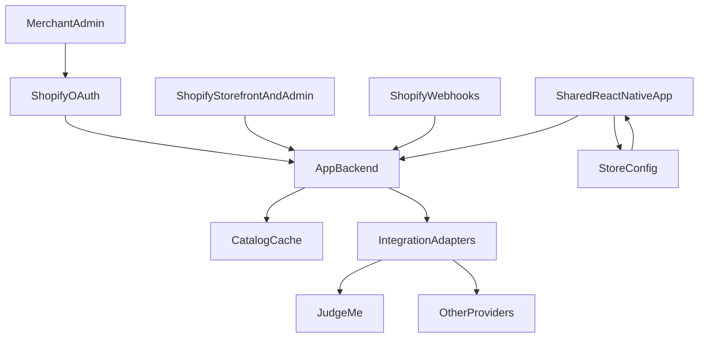

# Architecture and integration plan

This document describes a reusable React Native platform that turns Shopify stores into branded Android and iOS apps. The prototype in this repository uses labelled sample data. The production shape below is what that code is built to grow into.

## System

The phone app never stores a Shopify Admin token. It sends the active store id to the backend. The backend loads that merchant's token, calls Shopify, and returns a stable catalog and cart payload. Store-specific branding stays in configuration, so the same screens render every merchant.

## Shared codebase and configuration

One Expo codebase ships every merchant app. A `StoreConfig` supplies:

- store id and brand name
- tagline
- colors and status-bar style
- ISO 4217 currency
- catalog id
- feature flags, including reviews

Screens read that config. They do not branch on a store id to pick colors, products, or features. Adding a merchant is a new config record plus a catalog mapping, not a copy of the screens.

| Change | How it ships |
|---|---|
| Colors, copy, currency, feature flags, catalog mapping | Configuration. No new binary. |
| App name, icon, splash, bundle id, store listing, deep-link scheme | New build and store release. |
| A Shopify app or theme customization with no API, metafields, or stable URL | Custom development, or an explicit unsupported state. |

JavaScript-only fixes can ship with an over-the-air update. Native module changes still need a store build.

## Merchant onboarding and credentials

1. The merchant installs the Shopify app from the admin.
2. Shopify OAuth grants the requested scopes. The app stores the offline access token on the backend, encrypted, keyed by shop domain.
3. The mobile app receives only a public store id and a short-lived session for the shopper. It does not embed Admin API tokens or private app secrets.
4. Storefront API access for catalog and cart uses a token that the backend issues or proxies. Customer login uses the Customer Account API, with OAuth handled so the refresh token stays on the server when possible.

Official references:

- Shopify OAuth: https://shopify.dev/docs/apps/build/authentication-authorization
- Customer Account API: https://shopify.dev/docs/api/customer

## Shopify APIs used in production

| Need | API |
|---|---|
| Products, variants, collections | Storefront GraphQL |
| Cart create, add, update, remove | Storefront Cart mutations |
| Checkout | `checkoutUrl` from the cart, opened in Shopify hosted checkout |
| Customer login and orders | Customer Account API |
| Catalog sync and app install | Admin API plus webhooks, server-side only |

The queries and mutations the client would send for products and cart live in [src/data/shopify/operations.ts](../src/data/shopify/operations.ts). This prototype does not execute them.

- Storefront API: https://shopify.dev/docs/api/storefront
- Cart: https://shopify.dev/docs/storefronts/headless/building-with-the-storefront-api/cart/manage
- Checkout Kit: https://shopify.dev/docs/storefronts/mobile/checkout-kit

Checkout stays on Shopify. The app does not collect card numbers. In production the app creates or updates a Storefront cart, reads `checkoutUrl`, and opens Shopify's checkout with a supported integration such as Checkout Sheet Kit. The prototype shows that explanation in a labelled demo modal and does not place an order.

## Backend, cache, sync, and adapters

The backend is the only component that holds Shopify credentials. It:

- verifies the shop session on each request
- caches product and variant payloads, invalidated by product and inventory webhooks
- maps Shopify money to integer minor units in the store's ISO currency
- exposes one product and cart interface to the app

Third-party features sit behind adapters with the same shape: success, unavailable, or hidden when the merchant turned the feature off. A new provider replaces the adapter. Screens stay the same. If the provider has no native API, the adapter returns a web URL or an unavailable result. A failure in reviews, loyalty, or analytics must not block browsing or the cart.

Webhook reference: https://shopify.dev/docs/apps/build/webhooks

## Releasing a separate merchant app

EAS Build (or the same pipeline) produces one binary per merchant with that merchant's application id, display name, and icons. Runtime config still controls theme and features. Store review is required for the first binary and for native changes. OTA updates cover JavaScript fixes inside the already-reviewed native shell.

## Third-party compatibility

Website apps and theme scripts do not run inside the native app. Each category below uses one representative provider.

| Category | Provider | Recommended approach | Fastest implementation | Failure or fallback | Documentation |
|---|---|---|---|---|---|
| Reviews | Judge.me | Reusable adapter | Read review metafields or the Judge.me API on the product screen | Hide the section only when the feature is off. If the provider fails, show a short unavailable message and leave purchasing intact | https://judge.me/api/docs |
| Loyalty | Smile.io | Reusable adapter | Show the signed-in customer's points from the Smile API | Hide the points module | https://dev.smile.io/ |
| Subscriptions | Shopify Subscriptions | Shopify-native | Sell a variant's selling plan through the Storefront cart | Offer the one-time variant | https://shopify.dev/docs/apps/build/purchase-options/subscriptions |
| Search | Shopify Search & Discovery | Shopify-native | Storefront `predictiveSearch` | Filter the loaded collection by title | https://shopify.dev/docs/api/storefront/latest/queries/predictiveSearch |
| Discounts and bundles | Shopify discounts | Shopify-native | `cartDiscountCodesUpdate` on the Storefront cart | Leave the code field unavailable and keep the cart usable | https://shopify.dev/docs/api/storefront/latest/mutations/cartDiscountCodesUpdate |
| Notifications | Expo Notifications and Klaviyo | Reusable adapter | Register the device token with the backend, which forwards it to Klaviyo | Keep in-app order messages only | https://docs.expo.dev/versions/latest/sdk/notifications/ and https://developers.klaviyo.com/en/docs/collect_email_and_sms_consent_via_api |
| Analytics | PostHog | Reusable adapter | Screen and add-to-cart events from a client SDK | Shopping works with analytics disabled | https://posthog.com/docs/libraries/react-native |
| Support | Gorgias | Web fallback | Open the merchant's chat page in a web view | Show the support email | https://developers.gorgias.com/ |
| Order tracking | Shopify order status | Shopify-native | Open the order status URL from the Customer Account API | Point the shopper to the order email | https://shopify.dev/docs/api/customer/latest/objects/Order |
| Returns | Loop Returns | Web fallback | Open the merchant's Loop portal URL | Link to the store's returns page | https://docs.loopreturns.com/ |

Classification used in the table:

- **Shopify-native:** Shopify already exposes the capability to the Storefront or Customer Account API.
- **Reusable adapter:** a provider API sits behind one interface so another merchant can switch vendors without new screens.
- **Web fallback:** the feature only exists as a website or portal URL.
- **Unsupported:** there is no API, metafield, or stable URL. The app says so instead of pretending the theme feature works.

## An unfamiliar Shopify app or theme customization

1. Check whether the app writes Storefront-visible data: products, variants, selling plans, metafields, or a cart attribute.
2. If it exposes an HTTP API, add an adapter. The screen already understands success and unavailable.
3. If it is only a page or a portal, open that URL and label it as a web fallback.
4. If it is Liquid, a script tag, or a theme section with no data source, it will not appear in the native app. Mark it unsupported or schedule custom UI. Do not assume a storefront feature works on mobile because it works on the website.

## Three technical risks

1. **Theme-only apps.** Reviews widgets, bundles, and upsells often exist only as theme code. Mitigation: adapters plus an unavailable or web fallback, and a written unsupported list per merchant. The shopping path does not depend on them.
2. **Checkout and payment.** A custom card form would take on PCI scope and break Shop Pay. Mitigation: create the cart through the Storefront API and open Shopify hosted checkout. The prototype does not simulate a successful payment.
3. **One store listing per merchant.** Bundle ids, icons, and review times do not scale if every visual tweak needs a new binary. Mitigation: white-label builds for identity, remote config for brand and features, and over-the-air updates for JavaScript.

## Recommended tools

- Expo and TypeScript for one Android and iOS codebase
- React Navigation native stack
- Zustand and AsyncStorage for the on-device cart in this prototype
- TanStack Query in production, for server cache and request de-duplication
- Shopify Storefront API and Checkout Sheet Kit in production
- EAS Build and EAS Update for per-merchant releases

This prototype does not install TanStack Query, Checkout Sheet Kit, or a backend. Those belong to the production plan above.

## What this repository implements

The app keeps the data layer behind `ProductRepository` and `ReviewsAdapter`. `MockProductRepository` and `MockReviewsAdapter` are the current implementations. UI screens do not import the sample catalogs. Replacing the mock repository with a Storefront client does not require new screens.

Cart rows persist as `{ variantId, quantity }` inside `cartsByStoreId`. Titles and prices are resolved from the active catalog when the cart renders. A request token drops catalog responses that belong to a store the shopper has already left.
